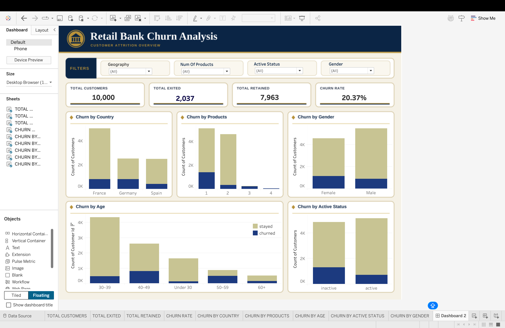

# Retail Bank Customer Churn Analysis

## Project Overview

Customer churn is an important challenge for retail banks because losing existing customers can affect customer retention and long-term business growth.

This project analyzes customer data to understand churn patterns, identify customer segments with higher churn rates, and provide insights that can support data-driven retention strategies.

The project uses Python for data cleaning and exploratory data analysis (EDA), SQL for additional business-focused analysis, and Tableau to present findings through an interactive dashboard.

## Business Objective

**Why are customers leaving the retail bank, and which customer segments show higher churn rates?**

The main objectives are to:

- Measure the overall customer churn rate.
- Identify customer segments associated with higher churn.
- Explore relationships between customer characteristics and churn.
- Present key findings through an interactive Tableau dashboard.
- Support data-driven customer retention decisions.

## Tools and Technologies

- **Python:** Data cleaning and exploratory data analysis
- **Pandas and NumPy:** Data manipulation and analysis
- **Matplotlib and Seaborn:** Data visualization during EDA
- **SQL (MySQL):** Data validation and business-focused queries
- **Tableau:** Interactive dashboard development
- **Jupyter Notebook:** Analysis workflow and documentation

## Project Workflow

1. **Data Cleaning:** Inspected the dataset, prepared columns for analysis, and handled data quality issues.
2. **Exploratory Data Analysis:** Analyzed overall churn and explored patterns across geography, age, number of products, and customer activity status.
3. **SQL Analysis:** Developed additional queries to investigate average account balance, estimated salary, credit-card ownership among churned customers, and churn across tenure groups.
4. **Dashboard Development:** Created a Tableau dashboard to communicate customer churn metrics and segment-level patterns.
5. **Business Interpretation:** Identified patterns that may help the bank investigate customer retention opportunities.

## 

## Key Performance Indicators

The analysis identified the following overall customer metrics:

| KPI | Value |
|---|---:|
| Total Customers | 10,000 |
| Churned Customers | 2,037 |
| Retained Customers | 7,963 |
| Overall Churn Rate | 20.37% |

These metrics establish the baseline for understanding the scale of customer churn.

## Exploratory Data Analysis

The Python EDA explored churn patterns across the following dimensions:

- **Geography:** Compared churn rates across customer locations.
- **Age Groups:** Examined differences in churn rates across age segments.
- **Number of Products:** Investigated churn patterns by the number of bank products held.
- **Customer Activity:** Compared churn rates between active and inactive customers.
- **Overall Churn:** Measured the proportion of customers who exited the bank.

### Selected Findings

- The overall customer churn rate was approximately **20.37%**.
- Germany had a higher churn rate than France and Spain in the analyzed dataset.
- Customers aged 50–59 showed a notably high churn rate.
- Inactive customers had a higher churn rate than active customers.
- Customers with three or four products showed high churn rates, although these groups contained relatively few customers compared with the one- and two-product groups.

These findings identify patterns for further investigation. They do not establish the actual reasons individual customers left.

## SQL Analysis

SQL was used to extend the Python EDA with additional business questions:

1. How do average account balances compare between churned and retained customers?
2. How do average estimated salaries compare between churned and retained customers?
3. How many churned customers have a credit card compared with those who do not?
4. How does churn vary across customer tenure groups?

The queries use foundational SQL concepts such as:

- `SELECT`
- `WHERE`
- `GROUP BY`
- `COUNT()`
- `SUM()`
- `AVG()`
- `CASE`
- Aggregate calculations

These analyses complement the existing EDA rather than simply repeating all of its questions.

## Tableau Dashboard

The Tableau dashboard provides a consolidated view of customer churn.

### KPI Cards

- Total Customers
- Total Exited
- Total Retained
- Churn Rate

### Visualizations

- Churn by Country
- Churn by Products
- Churn by Active Status
- Churn by Gender
- Churn by Age Group

The dashboard is designed to make customer churn patterns easier to compare and communicate.

## Business Recommendations

Based on the observed patterns, the bank could consider:

- Investigating the reasons behind higher churn in Germany.
- Reviewing customer experiences among age groups with higher churn rates.
- Exploring engagement strategies for inactive customers.
- Examining the needs and experiences of customers holding different numbers of products.
- Conducting further analysis to understand whether account characteristics are associated with churn.

Any retention strategy should be validated using additional customer feedback, transaction history, service interactions, or other relevant evidence.

## Limitations

- The dataset records whether a customer exited, but does not directly establish the reason for leaving.
- Observed relationships do not prove causation.
- Customer segments with relatively few records require careful interpretation.
- The analysis is based on the available dataset and may not represent all retail banking customers.

## Project Structure

A suggested repository structure is:

```text
Retail-Bank-Customer-Churn-Analysis/
├── README.md
├── Dashboard.png
├── churn_data_cleaning&eda.ipynb
├── cleaned_churn_data.csv
└── bank_churn_analysis.sql
```

## Conclusion

This project demonstrates an end-to-end data analytics workflow, from data cleaning and exploratory analysis to SQL-based investigation and Tableau dashboard development.

By identifying customer segments associated with higher churn, the analysis provides a foundation for further investigation and more informed customer retention decisions.

---

**Author:** Supreetham Jagabathina

**Focus Areas:** Data Analytics | SQL | Python | Exploratory Data Analysis | Tableau
